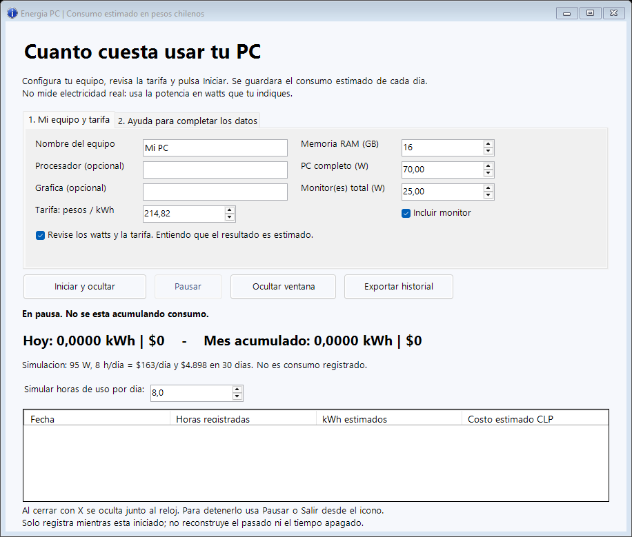

# Energia PC

**Calcula un estimado de cuánto cuesta usar tu computador y monitor, por día y por mes, en pesos chilenos.**

Es una aplicación para Windows. Completa tus datos, pulsa **Iniciar y ocultar** y seguirá registrando en segundo plano. Para volver a verla, usa el icono junto al reloj.

> **Es una estimación, no un medidor.** El programa multiplica los watts que indiques por el tiempo registrado y la tarifa eléctrica. No detecta el consumo real del enchufe ni cambia los watts automáticamente cuando juegas o navegas. Los modelos de procesador y gráfica son datos descriptivos.



## Descargar y abrir, paso a paso

Necesitas Windows 10 u 11 con Windows PowerShell 5.1 y las funciones de escritorio habituales. No necesitas instalar Python, pagar una suscripción ni tener cuenta de GitHub. No requiere permisos de administrador.

1. En esta página, pulsa el botón verde **Code** y después **Download ZIP**.
2. Busca el ZIP en Descargas. Haz clic derecho y selecciona **Extraer todo**.
3. Abre la carpeta extraída. Conserva todos sus archivos y la carpeta `lib` juntos.
4. Haz doble clic en **Iniciar.vbs**. Se abrirá la ventana sin una consola negra detrás.
5. Completa los datos y revisa la casilla que confirma que entiendes la estimación.
6. Pulsa **Iniciar y ocultar**. La ventana desaparecerá y comenzará el registro.

Si no se ejecuta el archivo VBS, prueba **Iniciar.cmd**, que abre la misma aplicación con una consola. Algunas instalaciones de Windows deshabilitan Windows Script Host. Si tu organización bloquea scripts, consulta con su administrador. El lanzador usa una política temporal para ese proceso de PowerShell; no modifica la política permanente del equipo.

## Qué poner en cada campo

| Campo | Qué significa |
|---|---|
| Nombre del equipo | Un nombre que reconozcas, como «Mi computador». |
| Procesador / Gráfica | Opcionales. Puedes dejarlos vacíos. No se usan para adivinar el consumo. |
| Memoria RAM | Capacidad en GB; es un dato descriptivo. |
| PC completo (W) | Potencia media que quieres suponer para todo el PC, incluida la fuente. **70 W es solo un ejemplo**, no una medición de tu equipo. |
| Monitor(es) total (W) | Consumo típico supuesto de la pantalla. Si tienes varias, suma sus watts. **25 W es solo un ejemplo.** |
| Incluir monitor | Desmárcalo para excluir el monitor del cálculo. No detecta cuándo se apaga solo. |
| Tarifa: pesos / kWh | Precio que usarás por cada kWh. **Los $200 iniciales son un ejemplo**, no una tarifa oficial. |

**¿No sabes los watts de tu PC?** Puedes explorar una estimación modificando ese campo, pero no podrás conocer el valor preciso por el modelo de procesador, la RAM o los watts de la fuente. Una fuente de 500 W no consume siempre 500 W. El TDP del procesador tampoco representa el consumo de todo el computador. Para calibrarlo con precisión necesitas un medidor de enchufe. Para el monitor, consulta el consumo típico en la ficha de tu modelo.

### Sacar una tarifa aproximada de la boleta

Busca una línea como **Electricidad consumida** y el consumo del mismo período en **kWh**.

Ejemplo ficticio para explicar el cálculo:

```text
Electricidad consumida: 200 kWh
Monto de ese cargo:     $40.000
40.000 dividido por 200 = $200 por kWh
```

Para tarifas con decimales, usa coma o punto según el separador de tu Windows.

El resultado de esa división representa ese cargo; pueden faltar transporte, otros cargos variables o impuestos. Revisa si los montos incluyen IVA. Dividir el total a pagar por los kWh puede incluir cargos fijos, deudas o subsidios y no equivale necesariamente al costo adicional de usar el PC. Cada persona debe revisar su propia boleta.

## Usarlo sin ver la ventana

- **Iniciar y ocultar:** empieza el registro y oculta la interfaz.
- **Doble clic en el icono junto al reloj:** vuelve a abrir la interfaz. Si no aparece, mira dentro de la flecha **^** de iconos ocultos de Windows.
- **Clic derecho en el icono → Pausar registro:** deja de acumular consumo.
- **Clic derecho → Salir y detener:** guarda y cierra el programa.
- **La X de la ventana la oculta:** no detiene el registro. Usa el menú del icono para salir.

Para cambiar watts, monitor o tarifa, primero **Pausar**, luego editar y volver a **Iniciar y ocultar**. Los cambios afectan al consumo futuro; no recalculan el historial. Cuando vuelvas a abrir la aplicación después de salir, empieza en pausa para que puedas revisar tu configuración.

No se instala al iniciar Windows. Si apagas el PC, deberás abrirla e iniciar el registro otra vez. Solo una instancia puede registrar por sesión de Windows; si intentas abrir otra, te indicará dónde encontrar el icono.

## Entender los resultados

- **Hoy:** consumo estimado registrado en la fecha local actual.
- **Mes acumulado:** lo registrado desde el día 1 del mes actual; no incluye días anteriores a la instalación.
- **Simulación:** calcula cuánto costarían las horas diarias elegidas durante 30 días con los valores actuales. **No es consumo registrado ni una predicción de tu cuenta.**
- **Historial:** resumen por fecha. **Exportar historial** guarda un CSV que puedes abrir con Excel o LibreOffice; el archivo usa punto y coma como separador.

Los pesos se muestran redondeados; se conserva mayor precisión en los cálculos internos. Por eso el total puede tardar algunos minutos en pasar de $0 a $1.

### Un ejemplo sencillo

Un PC supuesto de 70 W y un monitor de 25 W suman 95 W. Con 8 horas al día:

```text
95 × 8 / 1000 = 0,76 kWh por día
0,76 × $200 = $152 por día
$152 × 30 = $4.560 por 30 días
```

Ese ejemplo usa $200/kWh y potencias supuestas. Cambia los valores por los que correspondan a tu caso.

## Qué registra y dónde lo guarda

Guarda la configuración y los totales diarios **en tu propio equipo**, en:

```text
%LOCALAPPDATA%\EnergiaPC
```

Puedes pegar esa ruta en la barra del Explorador de archivos. `config.json` contiene tu configuración y `historial.json` tus totales. El programa mantiene un respaldo `.bak` y escribe mediante un archivo temporal para reducir el riesgo de archivos incompletos. Para hacer un respaldo personal, cierra el programa y copia esa carpeta.

No se conecta a Internet, no recopila contraseñas y no envía datos a GitHub. Tu historial y configuración están fuera de la carpeta del código y no se incluyen al publicar el proyecto. Si compartes una captura, revisa los datos que muestra.

## Límites que debes conocer

- Usa potencia constante según tus ajustes. No lee sensores de energía ni detecta tu actividad.
- No registra el consumo del PC apagado o suspendido. Al recibir una transición de energía se reinicia el intervalo. También se descartan huecos de más de 30 segundos y diferencias entre el reloj de Windows y el tiempo activo; puede omitirse un pequeño intervalo alrededor de suspensión/reanudación o cambios del reloj.
- Se guarda aproximadamente cada 5 segundos. Un cierre forzado puede perder el intervalo pendiente.
- Si falla el guardado, detiene el registro, abre la ventana y muestra el error; no continúa en silencio.
- El día y mes siguen la fecha local de Windows. Si quieres seguir el ciclo de facturación de tu compañía, exporta el historial y suma las fechas correspondientes.
- Los totales del día combinan las sesiones registradas en ese equipo aunque cambies su nombre; los campos de hardware no crean perfiles separados.
- El total en pesos depende de la tarifa que ingreses; no reemplaza la boleta de tu compañía.
- No migra automáticamente datos de versiones anteriores del script.

## Para quien quiera revisar el código

Todo está hecho con PowerShell, Windows Forms y componentes de Windows, sin módulos externos.

```text
EnergiaPC.ps1            Interfaz, icono y registro
lib/Energy.Core.ps1      Cálculos y guardado del historial
Iniciar.vbs             Apertura sin consola
Iniciar.cmd             Apertura alternativa con consola
tests/Test-Core.ps1      Pruebas de cálculos y persistencia
```

Ejecuta las pruebas desde la carpeta del proyecto:

```powershell
powershell.exe -NoProfile -ExecutionPolicy Bypass -File .\tests\Test-Core.ps1
```

La prueba de integración de interfaz usa una carpeta de datos aislada:

```powershell
powershell.exe -NoProfile -ExecutionPolicy Bypass -STA -File .\EnergiaPC.ps1 -SmokeTest -DataDirectory "$env:TEMP\EnergiaPC-prueba"
```

Se valida el inicio, ocultar la ventana, el icono activo, el registro en segundo plano, volver a abrir, pausar, persistencia y decimales. La integración necesita una sesión de escritorio Windows; GitHub Actions ejecuta las pruebas del núcleo y la validación de sintaxis.

Licencia MIT. Puedes usar, modificar y compartir el proyecto manteniendo la licencia.
